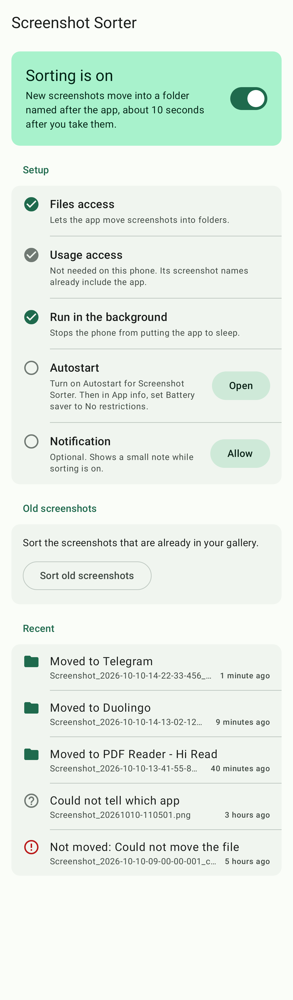

# Screenshot Sorter

An Android app that files every new screenshot into a folder named after the app it was taken in. Your gallery then shows one album per app (Telegram, Duolingo, YouTube, ...) instead of one long Screenshots album.



## Download

Get the latest APK from the [Releases](../../releases) page and open it on your phone. The app is not on Google Play, so Android will ask you to allow installing apps from that source, and Play Protect may warn that the developer is unknown.

Needs Android 6.0 or newer. So far it has been tested on a Redmi 9A (MIUI). Other phones should work but have not been tried yet; if something goes wrong on yours, please [open an issue](../../issues) with your phone model and Android version.

## How it works

- It watches the phone's screenshot folder (`DCIM/Screenshots` or `Pictures/Screenshots`).
- 10 to 20 seconds after a screenshot appears, it moves the file into a subfolder named after the app, for example `DCIM/Screenshots/Telegram/`. The wait keeps the system's edit and share preview working.
- It finds the app from the filename when the phone puts it there: Xiaomi, Redmi and POCO write the app's ID, Samsung writes the app's name. On other phones it asks Android which app was on screen at that moment (the Usage access permission).
- Only screenshots taken after you switch sorting on are moved automatically. Older ones are moved only when you tap **Sort old screenshots** and confirm the count.
- It never deletes, copies or overwrites anything. A move is a rename on the same storage, and if a file with the same name is already there, the new one gets ` (1)` added.
- It keeps working after a reboot, and catches up on anything it missed while the phone had stopped it.

## Permissions

| Permission | Why |
|---|---|
| All files access (Android 11+), Storage (Android 6 to 10) | To move screenshots into folders |
| Usage access | Only on phones whose screenshot names do not say which app they came from |
| Ignore battery optimisation, Autostart (Xiaomi, Oppo, Vivo, Huawei) | So the phone does not stop it in the background |
| Notifications (Android 13+) | Optional; shows a small note while sorting is on |

The app has no internet permission. Nothing leaves your phone.

## Building

You need JDK 17 and the Android SDK with the API 37 platform.

```bash
./gradlew assembleDebug
./gradlew testDebugUnitTest
```

Build output goes to `~/.screenshot-sorter-build/` instead of `build/` (set in the root `build.gradle.kts`). A signed release build reads its key from a `keystore.properties` file in the project root, which is not part of the repository.

The code is split into `core/` (plain Kotlin: filename parsing, deciding the app, the sorting pass), `platform/` and `watch/` (Android permissions, the background service, the boot receiver, the catch-up job) and `ui/` (one Jetpack Compose screen). The design and the build plan are in `docs/superpowers/`, and `docs/phone-test-checklist.md` is the checklist for testing on a real phone.

## License

[MIT](LICENSE)
